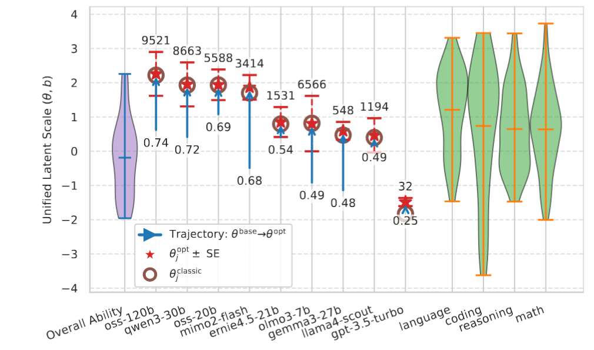

# Reasoning-Aware IRT

## Installation
```
pip install -e .
```

## Reproduce Paper Results
We prepare all reproducible results from paper via interactive-readable notebooks.
All notebooks are in `/paper_notebooks/`

| Figure / Table | Notebook files | Main Finding | Section |
| :--- | :--- | :--- | :--- |
| **Fig 1(a)** | fig1a.ipynb | Rank-stability | 4.1  |
| **Fig 1(b)** (LiveBench Part) | fig1b_livebench_part.ipybnb | ROC-AUC | 4.1 |
| **Fig 2** | fig2_posthoc.ipynb | Unified Benchmark-Ability Diagram | 4.2  |
| **Fig 3** | fig3_4.ipynb | Descriptive Insights | 4.2-4.3 |
| **Fig 4(a)** | fig3_4.ipynb | Descriptive Insights | 4.3 |
| **Table 2-3** | fig2_1st_pass.ipynb | Hyperparameter Pre-Experiments | D.1 |
| **Table 4** | fig2_posthoc.ipynb | Full GEM Results | D.2 |
| **Table 6** | fig1a.ipynb | Significance Tests - 1 | D.4 |
| **Table 7** | fig1b_livebench_part.ipynb | Significance Tests - 2  | D.4 |

### Misc
For other results which `OPENROUTER_API_KEY` is needed: 
* **Data Preparation**: Firstly, downloading all data from `https://huggingface.co/datasets/livebench/`. Filter only models having reasoning traces in `https://huggingface.co/datasets/livebench/model_answer`, then follow the evaluation process in our notebook : `Livebench_evaluation.ipynb` to produce $Y_{ij}$, $B_{ij}$ and $c_{i}$ (We have already done this process so that all notebooks listed above can be reproducible) 

* **Run New Models on LiveBench**: Follow our inference notebook: `Livebench_inference.ipynb`, then evaluate with `Livebench_evaluation.ipynb`

* **Run on New Datasets (e.g. GPQA-Diamond / MMLU-Pro)**: Downloading the dataset, and format the dataset as shown in `data/livebench_reasoning_problems.csv`. Then simply follow `Livebench_inference.ipynb` and `Livebench_evaluation.ipynb`

* **Fig.4 (b)** : Simply selected problems with desired $b_i$ range ($b_i$ is already prepared by `fig2_posthoc.ipynb`, see how to load with `fig3_4.ipynb`). Then follow `Livebench_inference.ipynb`, `Livebench_evaluation.ipynb` and use rejection sampling as explained in the paper.