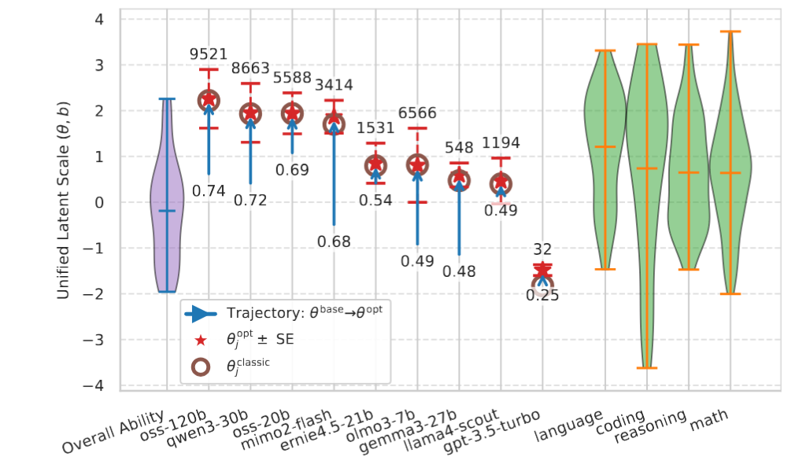

<br/>
  <h1 align="center" style="font-size: 1.7rem">Reasoning-Aware IRT : Explainable Evaluation of Test-Time Scaling in Reasoning Models</h1>
  <p align="center">
  NeurIPS 2026
  </p>
  <p align="center">
    <a href="https://thaiagi.substack.com/">Ratthachat Chatpatanasiri</a>,
  </p>
  <p align="center">
    <a href="https://neurips.cc/virtual/2026/loc/sydney/poster/139400">
      
    </a>
  </p>
</p>

# Introduction
**Item Response Theory (IRT)** is a *interpretable and robust* psychometric framework for modeling latent test-taker ability. It is widely used in high-stakes testing programs, including TOEFL, GRE, and SAT. Unlike raw accuracy, IRT's model called *three-parameter logistic* (3PL) jointly estimates test-taker ability and the the following problem characteristics: *problem difficulty*, *problem discrimiation & ambiguity*, as well as *guessing probability*. Prior works have therefore applied IRT to model evaluation as an interpretable and rank-stabilizing alternative to raw accuracy scores.

# Our Reasoning-Aware IRT
<div align="center">
    
</div>

The emergence of **test-time scaling** in reasoning models introduces a critical new dimension: *compute budget*. Although intensive test-time compute indeed enables reasoning models to make substantial progress on solving highly challenging benchmarks, many recent works also show that excessive reasoning can become counterproductive (e.g. the *overthinking* phenomenon). Since a direct application of classical IRT to reasoning models collapses intrinsic ability and test-time compute into a single static score, **classical IRT cannot explain when additional budget helps, how much is needed, or when excessive reasoning becomes inefficient**.

In this work, we extend the classical 3PL into **reasoning-aware 3PL** with the following three key take-aways:

* Reasoning-aware 3PL preserves important classical 3PL properties: it is more stable and has more generalization power than raw-accuracy
* Reasoning-aware 3PL separates baseline ability from test-time scaling, quantifying both how much additional computation improves each model's effective ability and where that improvement reaches its estimated maximum.
* Reasoning-aware 3PL could identify and quantify a potential *budget-inefficient regime* of test-time scaling via the downward curvature and can be confirmed by a stratification analysis.

## Installation
```
pip install -e .
```

# How to use our program
We have prepared tutorial-style notebook that you can easily follow.

## Data Preparation
The inputs of our reasoning-aware 3PL are simply two matrices of the same size *I x J* and a vector $\mathbf{c}$ of size *I*, where *I* is the number of items i.e. the total number of problems in your dataset and *J* is the number of models to be evaluated.
* $\mathbf{Y}$ : the accuracy matrix (also called the response matrix), where each value ${Y}_{ij} \in [0,1]$ denotes the accuracy of a model *j* on a problem *i*.
* $\mathbf{B}$ : the budget matrix, where each value ${B}_{ij}$ is an integer denoting the reasoning tokens that a model *j* used on a problem *i*.
* $\mathbf{c}$ : the pseudo-guessing vector, where each value ${c}_{i} \in (0,1]$ denotes a probability of correctness by random guessing e.g. for 0.20 a 5-choices question, or 0.01 for a 100-choice question. For a problem where random guessing is negligible, a small $\epsilon$ could be used (we used $10^{-5}$ in the paper).

See **Data Loading** section in `fig2_1st_pass.ipynb` for examples of the input matrices, as well as how to call our GEM to fit the reasoning-aware 3PL.

### Notational convention used in the code
Since python program doesn't have bold-face to indicate whether a variable is of type high-dimensional tensor, matrix, vector or simply scalar, we adopt our own convention to make this obvious: we simply explicitly write in each name the indices it need. For examples,

```
Y_ij, B_ij # Two input matrices with indices i & j
c_i # an input vector with index i
gamma_j, kappa_j # vectors with indices j
w_post_jk # a posterior weight matrix with indices j & k (see Eq.(4) in the paper)
```

### Running GEM
Please see details in `fig2_1st_pass.ipynb`, but basically after user already prepare data in `Y_ij, B_ij` and `c_i`

```
from reasoning_aware_irt.gem_quad import CalibrationData, CalibrationConfig
from reasoning_aware_irt.gem_quad import ReasoningAware3PLQuadraticCalibrator as ReasoningAware3PLCalibrator

data = CalibrationData(Y_ij=Y_ij, B_ij=B_ij, c_i=c_i)
cfg = CalibrationConfig()
calibrator = ReasoningAware3PLCalibrator(cfg)

# fit each parameter as explained in the paper
fit_results = calibrator.fit(data, strict_Y_int=strict_Y_int, init_param_dict=init_param_dict)

# calculate Louis standard error as explained in Appendix A
out = compute_louis_se(result=fit_results, data=data) # Section 3.4 and Appendix A
```


## Reproduce Paper Results
We prepare all reproducible results from paper via interactive-readable notebooks.
All notebooks are in `/paper_notebooks/`

| Figure / Table | Notebook files | Main Finding | Section |
| :--- | :--- | :--- | :--- |
| **Fig 1(a)** | fig1a.ipynb | Rank-stability | 4.1  |
| **Fig 1(b)** (LiveBench Part) | fig1b_livebench_part.ipybnb | ROC-AUC | 4.1 |
| **Fig 2** | fig2_posthoc.ipynb | Unified Benchmark-Ability Diagram | 4.2  |
| **Fig 3** | fig3_4.ipynb | Descriptive Insights | 4.2-4.3 |
| **Fig 4(a)** | fig3_4.ipynb | Descriptive Insights | 4.3 |
| **Table 2-3** | fig2_1st_pass.ipynb | Hyperparameter Pre-Experiments | D.1 |
| **Table 4** | fig2_posthoc.ipynb | Full GEM Results | D.2 |
| **Table 6** | fig1a.ipynb | Significance Tests - 1 | D.4 |
| **Table 7** | fig1b_livebench_part.ipynb | Significance Tests - 2  | D.4 |

### Misc
For other results which `OPENROUTER_API_KEY` is needed: 
* **LiveBench Data Preparation**: Firstly, downloading all data from `https://huggingface.co/datasets/livebench/`. Filter only models having reasoning traces in `https://huggingface.co/datasets/livebench/model_answer`, then follow the evaluation process in our notebook : `Livebench_evaluation.ipynb` to produce $Y_{ij}$, $B_{ij}$ and $c_{i}$ (We have already done this process so that all notebooks listed above can be reproducible)

* **Run New Models on LiveBench**: Follow our inference notebook: `Livebench_inference.ipynb`, then evaluate with `Livebench_evaluation.ipynb`

* **Run on New Datasets (e.g. GPQA-Diamond / MMLU-Pro)**: Downloading the dataset, and format the dataset as shown in `data/livebench_reasoning_problems.csv`. Then simply follow `Livebench_inference.ipynb` and `Livebench_evaluation.ipynb`

* **Fig.4 (b)** : Simply selected problems with desired $b_i$ range ($b_i$ is already prepared by `fig2_posthoc.ipynb`, see how to load with `fig3_4.ipynb`). Then follow `Livebench_inference.ipynb`, `Livebench_evaluation.ipynb` and use rejection sampling as explained in the paper.